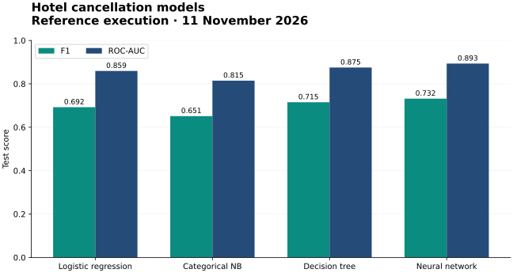

# Hotel Booking Cancellation Prediction

[](https://github.com/yiqunqiao/hotel-booking-cancellation/actions/workflows/ci.yml)


**Compare four cancellation models on shared booking data, then inspect feature ablation and cross-hotel transfer.**

A COMP90049 team project with executable notebooks, the complete input dataset, saved results and a reproducible runner. **Yiqun Qiao contributed decision-tree and neural-network modelling and evaluation.**



## Run the project

```sh
python3 -m venv .venv
source .venv/bin/activate
pip install -r requirements.txt
python run_notebooks.py
```

Use `.venv\Scripts\activate` on Windows. The runner executes every code cell through IPython, saves notebook outputs, and runs the notebooks in dependency order. The complete reference execution took about 19 minutes, mostly neural-network training.

For a shorter modelling run:

```sh
python run_notebooks.py preprocessing decision_tree
```

The data is bundled at `data/hotel_bookings.csv.xz`; The preprocessing notebook restores it from the bundled `.b64` file automatically, then pandas reads it directly. No course account, extra feature module or manual data download is needed.

## Reference evaluation

**11 November 2026 · Python 3.12 · all 83 code cells across five notebooks executed successfully.**

| Model | Accuracy | F1 | ROC-AUC |
| --- | ---: | ---: | ---: |
| Logistic regression | 0.7526 | 0.6923 | 0.8594 |
| Categorical Naive Bayes | 0.7403 | 0.6514 | 0.8146 |
| Decision tree | 0.7668 | 0.7153 | 0.8751 |
| Neural network | **0.8064** | **0.7317** | **0.8934** |

This execution uses **83,815 training / 18,237 validation / 17,338 test** bookings and 24 predictors. Thresholds and hyperparameters are chosen on validation data. Identical booking feature vectors stay in the same split. Outcome-related variables are excluded from model inputs.

These are newly reproduced results in the pinned environment; they may differ from historical coursework outputs. The table reports binary cancellation-class F1, rather than macro-F1. [Machine-readable results](docs/results.json) and [execution record](validation.json) accompany the executed notebooks.

## Notebook guide

| Notebook | Role |
| --- | --- |
| [Preprocessing](preprocessing.ipynb) | Missing values, feature construction, group-aware splits and training-derived imputation |
| [Logistic regression](logistic_regression.ipynb) | Baselines, regularisation, threshold selection and error analysis |
| [Naive Bayes](naive_bayes.ipynb) | Gaussian/categorical variants, calibration and comparison with logistic regression |
| [Decision tree](decision_tree.ipynb) | Tree tuning, feature ablation, cross-hotel evaluation and error inspection |
| [Neural network](neural_network.ipynb) | Hidden-layer tuning, thresholds, training diagnostics, feature ablation and transfer |

The runner executes preprocessing first, followed by logistic regression before Naive Bayes, then the tree and neural network. Generated splits are written to `shared_data/`; model artefacts and detailed analyses go to `outputs/` and stay local.

## Provenance

Adapted from the team repository [YuxuanLin050309/IML-Assignment2](https://github.com/YuxuanLin050309/IML-Assignment2), with original notebook attribution retained. Decompressing the bundled data reproduces the original `hotel_bookings.csv` byte for byte (119,390 rows). The portfolio version removes one unused `import features`, adds portable execution and pinned dependencies, and retains fresh notebook outputs and selected result artefacts.

